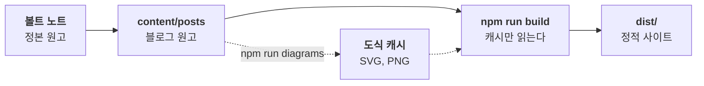

구조나 흐름은 말보다 그림이 빠르다. 이 블로그는 그림 파일 대신 본문의 `mermaid` 코드 블록으로 도식을 쓴다. **도식의 원본도 글과 같은 마크다운 안에 있다.**

*코드로 렌더링한 도식. 원고가 정적 사이트가 되는 흐름과, 도식만 미리 렌더해 캐시로 두는 구조를 보여 준다.*

## 렌더는 미리, 빌드는 가볍게
`npm run diagrams`가 펜스마다 두 폭(본문용 732px, 폰용 340px)의 SVG를 만들어 `content/diagrams/`에 저장하고, RSS와 뉴스레터용 PNG를 `content/images/{slug}/`에 둔다. 도식 글자만 담은 글꼴 부분집합도 함께 만든다. 배포 빌드는 이 캐시만 읽으므로 브라우저도 네트워크도 필요 없다.

펜스 바로 다음 줄의 이탤릭 한 줄이 캡션이다. 캡션은 `코드로 렌더링한 도식.`으로 시작하고, `content/image-captions.json`에 `diagram:{slug}:{해시}` 기록을 둔다. 강조는 색 대신 `%% @key`, `%% @interp`, `%% @aux` 지시문으로 한다. 라이트와 다크 테마가 같은 소스에서 나온다.

렌더러는 옵시디언 팀이 공개한 Mermaid 렌더러 Pele를 쓴다.

## 지금의 한계
렌더 단계는 Pele 테마, 검사기, 렌더러를 묶은 `cmds-pele` 도구 모음이 옆 폴더에 있어야 돈다. 이 도구 모음은 아직 공개 전이다. 그래서 지금은 이 글처럼 이미 렌더된 도식만 쓸 수 있다.

도식 소스를 고치면 빌드가 `run npm run diagrams`라는 메시지와 함께 멈춘다. 도식이 필요 없다면 이 글을 지우면 된다. 도식이 없는 글만으로도 블로그는 모든 기능이 그대로 동작한다.
